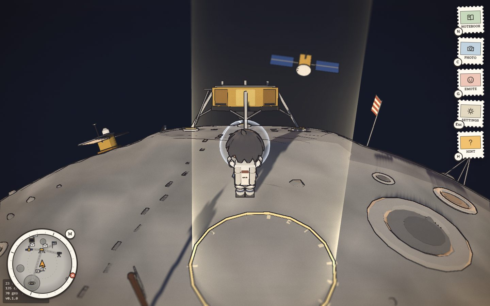

# Pieces of Home

> Left behind. Still shining.

A cozy 3D browser game for 1 to 4 players. Remi, who is 11, goes back to their late dad's workshop for the first time. Dad left a robot he never finished, a notebook, little worlds under glass, and letters he never sent, each one addressed to a machine people left on the Moon, on Mars or far out in space. Remi steps inside Dad's dioramas of real NASA sites, delivers the letters, and finishes the robot, Milo, one engineering idea at a time.

Our entry for the **NASA Space Apps Challenge 2026**, challenge *Abandoned but not Forgotten: Storytelling about NASA's Discarded Equipment on the Moon and Mars*.

**Play it:** https://piecesofhome.pages.dev (free, no install, no account)



## The idea

Most of what NASA left on the Moon and Mars is not junk. Some of it still works, some of it is still teaching us, and all of it marks a moment people reached somewhere new. The game tells that story from a child's point of view: a dad who loved these machines, and a kid who finds out why.

- **Six chapters, one little world each.** Prologue in Dad's workshop, then Tranquility Base (Apollo 11), Hadley-Apennine (Apollo 15), Meridiani Planum (Opportunity), Valinor Hills (Ingenuity), a bonus trip to the Ocean of Storms (Surveyor 3 and Apollo 12), and a finale with the backyard dish listening for Voyager 1.
- **One real idea per world, learned with your hands:** corner-cube mirrors that send a laser straight back, mesh wheels, solar power and dust, flying in very thin air, and a message that takes almost a day to arrive.
- **Each lesson becomes a part of Milo**, and each delivered letter opens in Dad's handwriting and fills a page of his notebook.
- **No fail states, no timers, no score.** Friends hint when you are stuck. Every chapter can be opened at once with *Explore freely*, for teachers.

The full design is in [docs/GAME_BIBLE.md](docs/GAME_BIBLE.md).

## How to play

Open the link in a modern browser. It is built for a laptop and also runs on phones and tablets.

| Key | What it does |
|---|---|
| WASD or arrow keys | Walk (Shift to run) |
| Space | Jump |
| E or Enter | Look at, pick up, deliver |
| N | Dad's notebook |
| M | The big map (drag to spin, scroll to zoom) |
| C | Photo mode |
| G | Emotes (in co-op) |
| H | A hint |
| Esc | Settings |

A gamepad works everywhere, menus included. Keys can be changed in Settings. On a phone, an on-screen stick and buttons appear.

**Play together:** choose *Play together* from the menu and make a room. The room code is three friendly words and a number. Friends set the same code on paper tiles, or open the shared link. Each player is a different kid (Remi, Nori, Lumi or Theo) and the story is shared.

**Field Guide:** the whole story and every fact, with sources, opens from the menu inside the game and prints as a classroom handout. Computers without 3D get a plain [Field Guide page](https://piecesofhome.pages.dev/field-guide/) instead.

## Accuracy

- Every number, date and claim a player can see comes from [src/data/facts.json](src/data/facts.json), and every fact there has a source link and the day it was checked. `npm run check:facts` fails the build if game text uses a fact that is missing, unsourced or not yet verified.
- Voyager 1's distance is date-aware, from a JPL Horizons table, so it is right on the day you play.
- The dioramas are Dad's models and are labeled "Model, not to scale". Real NASA photos carry their exact credit line.

## Kid safety and privacy

No text chat, no voice chat, no usernames, no accounts, no analytics, no trackers, no ads. Co-op rooms are private, and players talk only with picture emotes and a few preset kind phrases. Progress is saved only in the player's own browser. The story includes the death of a parent; it is gentle, and the in-game About page has a short note for grown-ups.

## Accessibility

Subtitles for every spoken line, speech bubbles, text size, a dyslexia-friendly reading font, high contrast, reduced motion, read-aloud for notebook pages, key rebinding, full gamepad and keyboard menus, an optional guide arrow and corner map, and an automatic picture-quality setting for older machines.

## NASA data and media used

Every asset is listed with its source and license in [CREDITS.md](CREDITS.md) and [src/data/credits.json](src/data/credits.json). In short:

- Photos from the NASA Image and Video Library, JPL Photojournal and LROC (NASA/GSFC/Arizona State University)
- The CGI Moon Kit from NASA's Scientific Visualization Studio and the Viking Mars global mosaic from NASA Ames and USGS Astrogeology, for the painted globes
- Real mission recordings from NASA, each with a caption and a sourced fact
- Landing sites and mission facts from NSSDCA, NASA and JPL mission pages
- Voyager 1's distance, light time and place in the sky from JPL Horizons; star positions from the Yale Bright Star Catalog

NASA media is credited as NASA asks. NASA did not make, sponsor or endorse this game. The NASA insignia, logotype and seal are not used.

Other assets: sound effects from Kenney (CC0), instrument samples from the Versilian Community Sample Library (CC0), and fonts under the SIL Open Font License (Kalam, Fraunces, Atkinson Hyperlegible Next, Zilla Slab, OpenDyslexic). The 3D models, music and most sounds are made in code for this game.

## Run it yourself

Needs Node 22 or newer.

```bash
npm install
npm run dev          # http://localhost:5173, with the real Workers runtime and co-op rooms
```

| Command | What it does |
|---|---|
| `npm run dev` | Local dev with the Workers runtime and co-op rooms |
| `npm run build` | Fact check, then production build |
| `npm run typecheck` | Type check the browser, Worker and script code |
| `npm run test` | Unit tests (Vitest) |
| `npm run e2e` | Browser smoke, flow and co-op tests (Playwright) |
| `npm run e2e:live` | The smoke tests against the live site |
| `npm run check:facts` | Fail if any used fact lacks a source |
| `npm run deploy` | Build and deploy to Cloudflare |

## How it is built

- Vite, TypeScript (strict) and Three.js for the worlds, with a hand-written toon look: painted shading, ink outlines and paper grain
- Svelte 5 for the 2D layer: the notebook, letters, map, menus and panels
- Cloudflare Workers with static assets on the free tier; one `Room` Durable Object per room code (PartyServer) for co-op, with `partysocket` in the browser
- Music, voices and most sound effects made in code with the Web Audio API: the music is generative and adds one instrument for each friend in the room
- Vitest and Playwright, with automated accessibility checks (axe) on the menus, panels and notebook

Design and technical choices, with the reasons and the alternatives we weighed, are logged in [docs/DECISIONS.md](docs/DECISIONS.md). Where the build stands is in [docs/PROGRESS.md](docs/PROGRESS.md).

## Credits and license

Code is MIT. See [LICENSE](LICENSE). Assets and libraries are listed in [CREDITS.md](CREDITS.md).

## AI use disclosure

This project is built with the help of an AI coding assistant (Claude Code). The team directs the design, reviews the work and checks every fact against its source. Illustrations are drawn in the game's own style and read as illustrations; no AI-generated image is presented as a real NASA photo.
